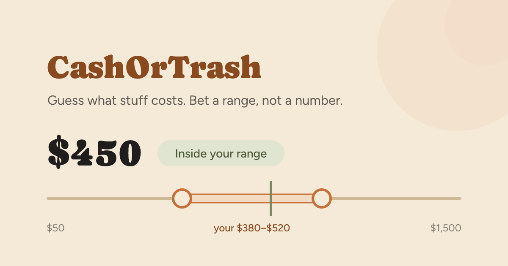

<div align="center">



<br><br>

[](https://apps.apple.com/app/id6805992515)
[](https://play.google.com/store/apps/details?id=fun.cashortrash.app)
[](https://cashortrash.fun)
<br>
[](src/)
[](docker-compose.prod.yml)

</div>

---

**How much is that, really?** CashOrTrash is a guess-the-price game for iOS and
Android. You see a car, a yacht, an apartment, a bottle of wine, a rare card,
and you have 10 seconds to say what it costs.

The twist: you don't pick a number, you **bet a range**. The tighter the range,
the bigger the multiplier. Miss and you score nothing. Play it safe or go for
the big score, it's your call.

This repository is the game server: the API the apps talk to, the scoring, the
daily challenge, head-to-head matches, the leaderboard, the item catalogue and
its admin portal, and the billing webhook.

CashOrTrash is a product of [Impossible Labs](https://impossiblelabs.xyz).

## 🎮 How to play

| Mode | What it is | Price |
|---|---|---|
| **Daily challenge** | Five items a day, the same five for everyone. Compare your score with the world. | Free |
| **Head-to-head** | Challenge a friend with a code, play the same items, and see who knows prices better. | Free |
| **Quick rounds** | Five random items, as many rounds as you like. | 5 free a day, unlimited with Premium |

Items come from categories like cars, yachts, planes, apartments, wines,
electronics, collectible cards and Apple products. The app is available in
English, Spanish, Portuguese and Italian, and shows prices in your own
currency.

**Premium** unlocks unlimited quick rounds for $1.99 a month or $14.99 a year.
Everything else stays free, with no ads.

## ⚙️ How it works

The server is the referee. The apps never see a price before the bet is in,
and every rule that matters for fair play is enforced here:

- **Timed on the server.** The 10-second clock starts when the server deals a
  round and is checked against the server's clock when the bet lands, with a
  small grace for network latency.
- **Daily items you can't look up.** Which items a day deals, and how each
  slider is laid out, come from keyed seeds. Nobody can compute tomorrow's
  challenge in advance.
- **Answers stay out of the wrong rounds.** Upcoming daily items are held out
  of quick and head-to-head play, where prices get revealed.
- **Purchases are verified.** Premium is always read back from RevenueCat with
  a secret key. The webhook only says whose entitlement to re-read.
- **A catalogue that writes itself.** Drop photos into `/admin` and an LLM
  rewrites each item's title and description in four languages. It is never
  shown the price, so it can't give the answer away.

## 🧱 Stack

| Layer | Choice |
|---|---|
| API | NestJS on Fastify, REST + Socket.IO for live matches |
| Data | Postgres (TypeORM, migrations) and Redis (cache, throttling, Socket.IO adapter) |
| Jobs | BullMQ queues for scheduled maintenance and billing |
| Media | `sharp` for item photos, served by the API or a CDN |
| Billing | RevenueCat (App Store and Google Play subscriptions) |
| Push | Expo push notifications |
| Deploy | Docker Compose with automatic TLS, daily database and media backups |

The mobile app (Expo / React Native) lives in a separate repository.

## 🛠️ Run it locally

You need Node 24 (see `.nvmrc`) and Docker.

```bash
cp .env.example .env    # development defaults work out of the box
make dev-deps           # Postgres and Redis in Docker
npm ci
npm run start:dev     # migrations run on boot
```

Or run the whole stack, with hot reload, in Docker:

```bash
make dev
```

Run `make help` to see every target, including `deploy`, `db-backup`
and `smoke`.

### Tests

```bash
npm run lint:check
npm test
npm run test:e2e        # needs Docker running
```

Before shipping to production, go through
[`RELEASE_CHECKLIST.md`](RELEASE_CHECKLIST.md). Production fails closed:
it won't start without its secrets.

## 📬 Contact

Questions, partnerships or press: **info@impossiblelabs.xyz**

Made in Malta by [Impossible Labs](https://impossiblelabs.xyz).
